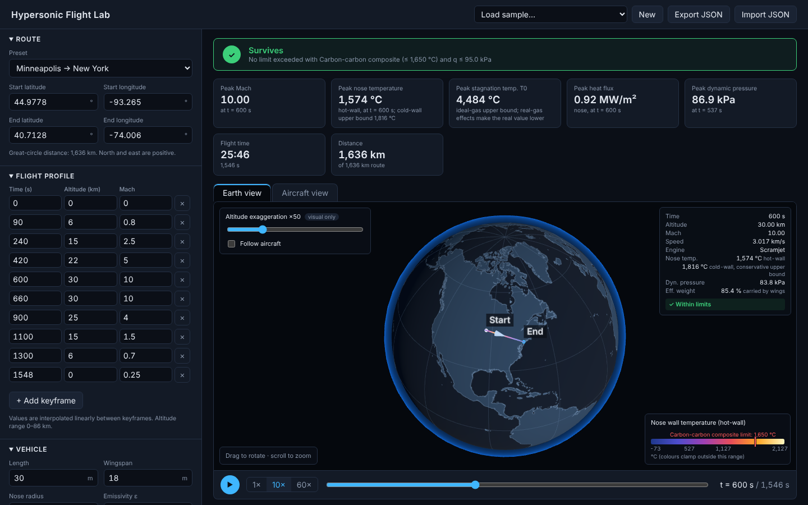
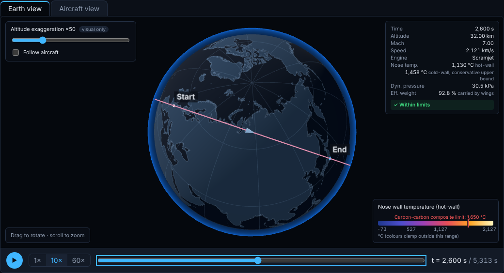
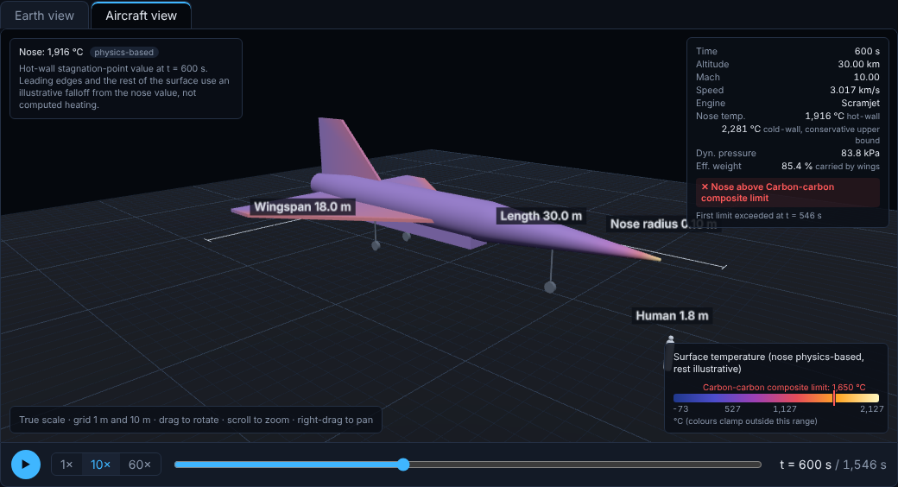
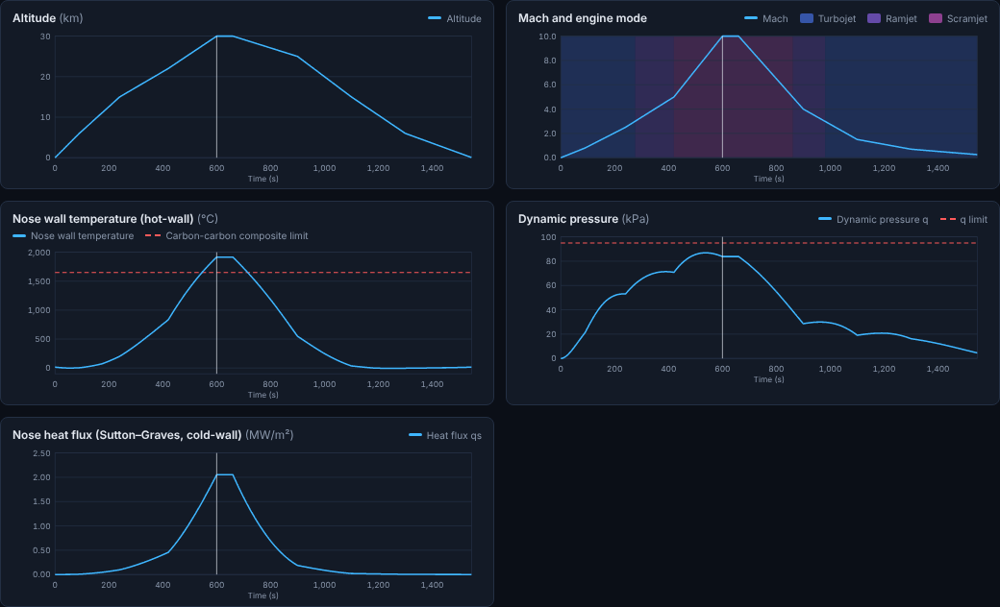
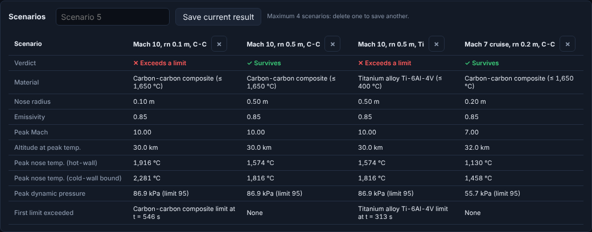

# Hypersonic Flight Lab

**Can the aircraft survive Mach 10, at what altitude, and with which material?**

Hypersonic Flight Lab is a browser-based physics simulation of a hypersonic flight. You define a route between two points on Earth and a flight profile (time, altitude, Mach); the app computes the atmosphere, airspeed, dynamic pressure, stagnation-point heating, nose wall temperature, engine mode and effective weight every second, and checks the result against a dynamic-pressure limit and the selected material's temperature limit.

The whole flight is shown on an interactive 3D Earth, next to a true-scale close-up of an original aircraft design with a heat map on its surface, a HUD, a shared playback timeline and 2D charts. Up to four scenarios can be saved and compared side by side.

*Inspired by the Mach 10 test flight in the film* Top Gun: Maverick *(2022). The app has no connection to the film; the aircraft is an original, generic design.*



| Earth view | Aircraft view |
| --- | --- |
|  |  |





## Features

- **Inputs:** route (start/end latitude and longitude, presets of real city pairs), flight-profile keyframes, vehicle (length, wingspan, nose radius, emissivity, nose material), dynamic-pressure limit, engine Mach ranges, editable materials list. Number fields accept a comma or a point as decimal separator; invalid values get a red border and a message and revert to the last valid value on blur.
- **Verdict:** "Survives" or "Exceeds *material* limit at t = … s" / "Exceeds dynamic pressure limit at t = … s", with symbols and text, not colour alone.
- **Summary cards:** peak Mach, peak nose temperature (hot-wall, with the cold-wall bound), peak ideal-gas stagnation temperature, peak heat flux, peak dynamic pressure, flight time, distance.
- **3D Earth:** land/ocean texture drawn from Natural Earth data, latitude/longitude grid, atmosphere glow, flight path coloured by nose temperature with a legend that marks the material limit, altitude exaggeration slider (×1 to ×200, *visual only*), start/end markers, aircraft marker, "Follow aircraft".
- **Aircraft close-up:** original parametric design at true scale (metres) with a 1 m / 10 m ground grid, dimension labels and a 1.8 m human figure; the nose radius is the same value the heating model uses.
- **Playback:** play/pause, 1×/10×/60×, scrubber. The aircraft on the Earth, the aircraft heat map, the HUD and a cursor on every chart stay in sync. The timeline opens at the moment of peak nose temperature.
- **Scenarios:** save up to four named result snapshots and compare them side by side.
- **Save/load:** automatic save in the browser, sample flights, New, Export JSON, Import JSON (validated; a clear error message keeps the current data; confirmation before replacing).

## Physics model

All physics lives in `src/physics` as pure functions (no React, no Three.js), uses SI units (m, s, K, Pa, kg/m³, W/m²), and is covered by unit tests. The formulas below are exactly those in the code.

### Atmosphere: US Standard Atmosphere 1976 (0–86 km)

Constants: R = 287.05287 J/(kg·K), γ = 1.4, g0 = 9.80665 m/s², r0 = 6,356,766 m (Earth radius for the geopotential conversion).

- Geopotential height: H = r0 × z ÷ (r0 + z), where z is the geometric altitude
- Seven layers with base heights (geopotential km) 0, 11, 20, 32, 47, 51, 71, base temperatures 288.15, 216.65, 216.65, 228.65, 270.65, 270.65, 214.65 K and lapse rates −6.5, 0, +1.0, +2.8, 0, −2.8, −2.0 K/km
- Temperature: T = Tb + L × (H − Hb)
- Pressure, L ≠ 0: p = pb × (Tb ÷ T)^(g0 ÷ (R × L))
- Pressure, L = 0: p = pb × exp(−g0 × (H − Hb) ÷ (R × Tb))
- Base pressures pb are chained from p = 101,325 Pa at sea level, so pressure is continuous at every boundary
- Density: ρ = p ÷ (R × T)
- Speed of sound: a = √(γ × R × T)
- Outside 0–86 km geometric altitude the function **throws an error** (no clamping), and the editor limits keyframe altitudes to that range

### Flight profile and route

- Keyframes { time, altitude, Mach } are interpolated linearly: x = x0 + (x1 − x0) × (t − t0) ÷ (t1 − t0)
- The route is the great circle between start and end on a sphere of mean radius R = 6,371,000 m
- Central angle (haversine): hav(θ) = sin²(Δφ ÷ 2) + cos φ1 × cos φ2 × sin²(Δλ ÷ 2), θ = 2 × asin(√hav); distance d = R × θ
- Position along the route at fraction f (spherical linear interpolation): p = [sin((1 − f) × θ) × a + sin(f × θ) × b] ÷ sin θ, with a and b the unit vectors of start and end
- Ground distance flown: s = ∫ v × R ÷ (R + h) dt, integrated with the trapezoidal rule at 1 s steps
- The simulation **ends on arrival**: when s reaches the route length, the arrival time is found by linear interpolation within the last step, and a note says that the remaining profile was not flown

### Flow quantities

- True airspeed: v = M × a
- Dynamic pressure: q = ½ × ρ × v²
- Ideal-gas stagnation temperature: T0 = T × (1 + (γ − 1) ÷ 2 × M²). **This is an ideal-gas upper bound.** At high Mach, real-gas effects (vibrational excitation, dissociation, γ falling below 1.4) make the real value lower.

### Nose stagnation-point heating

- Sutton–Graves heat flux (cold wall): qs = k × √(ρ ÷ rn) × v³, with k = 1.7415 × 10⁻⁴ (SI, air) and rn the nose radius in m
- **Cold-wall radiative-equilibrium temperature** (conservative upper bound): Tw,cold = (qs ÷ (ε × σ))^(1/4), σ = 5.670374 × 10⁻⁸ W/(m²·K⁴)
- **Hot-wall radiative-equilibrium temperature** (used for the verdict, charts and heat colouring): solve

  ε × σ × (Tw⁴ − T∞⁴) = qs × (1 − Tw ÷ T0)

  by bisection between the ambient temperature T∞ and T0.

**Why the hot-wall correction is needed.** Sutton–Graves gives the heat flux into a *cold* wall. Convective heating is driven by the difference between the gas recovery temperature and the wall temperature, so the flux into a hot wall is smaller. Without a correction, radiating the full cold-wall flux gives wall temperatures above the stagnation temperature at low speed, which is physically impossible: 711 K at Mach 0.8 at sea level, where T0 is only 325 K, which would make titanium "fail" on the runway. The factor (1 − Tw ÷ T0), the wall-to-stagnation enthalpy ratio of a calorically perfect gas, removes the flux as the wall approaches T0. The ambient term T∞⁴ accounts for radiation received from the surroundings, so that Tw = T∞ at Mach 0 instead of 0 K and the curve is smooth at low Mach. The result always lies between T∞ and T0. At Mach 10 and 30 km the ambient term changes Tw by only 0.002 %; the hot-wall correction lowers the nose temperature from 2,554 K to 2,190 K.

### Why hypersonic vehicles have blunt noses

Heating falls with the square root of the nose radius: qs ∝ 1 ÷ √rn. At Mach 10 and 30 km (ε = 0.85):

| Nose radius | Heat flux qs | Tw hot-wall | Tw cold-wall |
| --- | --- | --- | --- |
| 0.05 m | 2.90 MW/m² | 2,076 °C | 2,512 °C |
| 0.1 m | 2.05 MW/m² | 1,916 °C | 2,281 °C |
| 0.2 m | 1.45 MW/m² | 1,764 °C | 2,069 °C |
| 0.3 m | 1.19 MW/m² | 1,678 °C | 1,954 °C |
| 0.5 m | 0.92 MW/m² | 1,574 °C | 1,816 °C |
| 1.0 m | 0.65 MW/m² | 1,440 °C | 1,642 °C |

With rn = 0.1 m the nose exceeds the 1,650 °C limit of carbon-carbon; going to rn = 0.5 m divides the heat flux by √5 ≈ 2.24 and brings the same flight under the limit, as the two Mach 10 sample flights show. The price of a blunt nose is more wave drag, which this app does not model.

### Engine mode, gravity, limits

- **Engine mode** from Mach with editable inclusive ranges (default turbojet 0–3, ramjet 3–6, scramjet 5–12). Where ranges overlap, the higher-speed engine is chosen and the results say so; a shared boundary (Mach 3) is a handover, not an overlap. Outside every range the mode is "none".
- **Effective gravity:** g(h) = g0 × (R ÷ (R + h))²
- **Centrifugal relief** of level flight over a non-rotating spherical Earth: a_c = v² ÷ (R + h)
- **Weight carried by the wings:** (g(h) − v² ÷ (R + h)) ÷ g(h) × 100 %
- **Limits:** the first sample (1 s resolution) where q exceeds the maximum dynamic pressure (default 95 kPa), and the first sample where the hot-wall nose temperature exceeds the selected material's maximum service temperature

### Materials (approximate literature values)

| Material | Max. service temperature | Note |
| --- | --- | --- |
| Aluminium alloy 2024 | ≈ 150 °C | 120–175 °C depending on temper and exposure time |
| Titanium alloy Ti-6Al-4V | ≈ 400 °C | 350–450 °C long-term; higher only for short exposure |
| Nickel superalloy Inconel 718 | ≈ 650 °C | 650–700 °C for structural strength |
| Carbon-carbon composite | ≈ 1,650 °C | with an oxidation-protective coating (e.g. SiC); uncoated it oxidises in air from about 400–500 °C |

Values vary by source, exposure time and loading; all are editable in the app.

### Aircraft heat map

Only the **nose** value is physics-based (hot-wall stagnation-point temperature). The rest of the surface uses an **illustrative** falloff from the nose value, T = T∞ + (Tnose − T∞) × factor, with made-up shape factors: body 0.3 + 0.7 × exp(−s ÷ 0.05) (s = distance from the nose ÷ length), leading edges 0.3 + 0.35 × exp(−d ÷ 0.015) on the wings and 0.3 + 0.25 × exp(−d ÷ 0.015) on the fin (d = chordwise distance behind the leading edge ÷ length), 0.3 elsewhere. It shows the typical pattern (hot nose and leading edges, cooler aft surfaces); it is **not** computed heating. The colour scale is fixed from −73 °C to 2,127 °C so colours compare across flights.

## Validation

### Atmosphere vs U.S. Standard Atmosphere 1976 table (geometric altitude)

The tests require agreement within 0.1 %.

| Altitude | T model (K) | T table (K) | p model (Pa) | p table (Pa) | ρ model (kg/m³) | ρ table (kg/m³) | a model (m/s) | a table (m/s) | Max. deviation |
| --- | --- | --- | --- | --- | --- | --- | --- | --- | --- |
| 0 km | 288.150 | 288.15 | 101,325 | 101,325 | 1.2250 | 1.225 | 340.294 | 340.29 | 0.001 % |
| 11 km | 216.774 | 216.774 | 22,699.9 | 22,699.9 | 0.36480 | 0.36480 | 295.154 | 295.154 | < 0.001 % |
| 20 km | 216.650 | 216.65 | 5,529.30 | 5,529.3 | 0.088910 | 0.088910 | 295.069 | 295.069 | < 0.001 % |
| 30 km | 226.509 | 226.509 | 1,197.03 | 1,197.0 | 0.018410 | 0.018410 | 301.709 | 301.709 | 0.002 % |
| 47 km | 269.684 | 269.684 | 115.851 | 115.85 | 1.4965 × 10⁻³ | 1.4965 × 10⁻³ | 329.210 | 329.21 | 0.001 % |
| 71 km | 216.846 | 216.846 | 4.47953 | 4.4795 | 7.1965 × 10⁻⁵ | 7.1966 × 10⁻⁵ | 295.203 | 295.20 | 0.002 % |

The derived layer base pressures agree with the standard's (22,632.06 / 5,474.889 / 868.0187 / 110.9063 / 66.93887 / 3.956420 Pa) within 7 ppm; the tests also check continuity of T, p, ρ and a at every layer boundary.

### Hand-checked values at Mach 10, 30 km, rn = 0.1 m, ε = 0.85

| Quantity | Hand calculation | Model |
| --- | --- | --- |
| True airspeed v = 10 × 301.709 | 3,017.1 m/s | 3,017.09 m/s |
| Dynamic pressure q = ½ × 0.018410 × 3,017.09² | ≈ 84 kPa | 83.79 kPa |
| Stagnation temperature T0 = 226.509 × 21 | ≈ 4,760 K | 4,756.7 K |
| Heat flux qs = 1.7415 × 10⁻⁴ × √(0.018410 ÷ 0.1) × 3,017.09³ | ≈ 2.05 MW/m² | 2.052 MW/m² |
| Cold-wall Tw = (qs ÷ (0.85 σ))^¼ | ≈ 2,554 K | 2,554.4 K |
| Hot-wall Tw from ε σ (Tw⁴ − T∞⁴) = qs (1 − Tw ÷ T0) | ≈ 2,190 K | 2,189.5 K |
| Weight carried by wings (g 9.7149, relief 1.4221 m/s²) | ≈ 85.4 % | 85.36 % |

### Great-circle distance vs WGS84 ellipsoid (Vincenty)

| City pair | Model (sphere) | WGS84 geodesic | Deviation |
| --- | --- | --- | --- |
| London – New York | 5,570.2 km | 5,585.2 km | −0.27 % |
| Paris – Tokyo | 9,711.7 km | 9,735.3 km | −0.24 % |

The spherical model agrees within the 0.5 % required by the tests.

## Sample flights

| Sample | Route | Profile |
| --- | --- | --- |
| Mach 10 run – blunt nose (rn 0.5 m) | Minneapolis → New York, 1,636 km | Climb and accelerate through turbojet, ramjet and scramjet ranges to Mach 10 at 30 km (t = 600 s), hold 60 s, decelerate and descend; arrival at t = 1,545.5 s |
| Mach 10 run – sharp nose (rn 0.1 m) | same | same |
| Mach 7 cruise Paris → Tokyo (rn 0.2 m) | Paris → Tokyo, 9,712 km | Climb to Mach 7 at 32 km by t = 600 s, cruise, descend; arrival at t = 5,312.7 s |

Verdict for each sample with each material:

| Sample | Aluminium 2024 | Ti-6Al-4V | Inconel 718 | Carbon-carbon |
| --- | --- | --- | --- | --- |
| Mach 10 run, rn 0.5 m (peak nose 1,574 °C, peak q 86.9 kPa) | Exceeds limit at t = 221 s | Exceeds limit at t = 313 s | Exceeds limit at t = 394 s | **Survives** |
| Mach 10 run, rn 0.1 m (peak nose 1,916 °C, peak q 86.9 kPa) | Exceeds limit at t = 216 s | Exceeds limit at t = 303 s | Exceeds limit at t = 372 s | Exceeds limit at t = 546 s |
| Mach 7 cruise, rn 0.2 m (peak nose 1,130 °C, peak q 55.7 kPa) | Exceeds limit at t = 236 s | Exceeds limit at t = 327 s | Exceeds limit at t = 388 s | **Survives** |

All failures are on nose temperature; no sample exceeds the 95 kPa dynamic-pressure limit. The cruise shows titanium failing where carbon-carbon survives; the two Mach 10 runs show a larger nose radius bringing a failing flight under the carbon-carbon limit.

## Limitations

- **Ideal-gas stagnation temperature.** T0 uses constant γ = 1.4 and is an upper bound; at Mach 10 real-gas effects (vibrational excitation, dissociation) make the real value clearly lower. The hot-wall factor (1 − Tw ÷ T0) uses the same ideal-gas T0.
- **Physics-based heating at the nose only.** Sutton–Graves applies to the stagnation point of a blunt nose in continuum flow. The hot-wall correction is a simple enthalpy-ratio approximation, radiative equilibrium assumes no heat conducted into the structure (steady state, no thermal mass), and the surroundings are taken at the ambient air temperature.
- **Illustrative heat falloff elsewhere.** Leading-edge and body temperatures on the aircraft view are not computed.
- **No trajectory dynamics.** The flight follows the given profile exactly; no forces are integrated, and lift, drag, thrust and the climb angle are not modelled. Ground distance assumes all speed is horizontal.
- **No fuel or mass model,** so range, endurance and weight changes are not checked.
- **Simplified engine ranges.** The engine mode is chosen from Mach ranges only; there is no thrust, inlet or combustion model.
- **Approximate material limits.** Service temperatures vary with alloy, temper, exposure time, coating and load; one number per material is a simplification.
- **Earth model.** A spherical, non-rotating Earth: the centrifugal relief ignores Earth's rotation (worth up to 465 m/s for an eastbound flight at the equator) and the climb angle; the great-circle distance is about 0.25 % shorter than on the WGS84 ellipsoid.
- **Atmosphere** is the 1976 standard day only (no weather, no seasonal or latitude variation) and ends at 86 km. Between 80 and 86 km it uses the molecular-scale temperature, which differs from the kinetic temperature by at most 0.04 %.
- **Time resolution.** Results are sampled every 1 s, so limit exceedance times are accurate to 1 s.

## Run locally

Requires Node.js 22.12 or newer.

```bash
npm install
```

```bash
npm run dev
```

Other scripts:

```bash
npm test
```

```bash
npm run lint
```

```bash
npm run build
```

`npm run coverage` reports test coverage of `src/physics`.

## Deploy

The repository includes `vercel.json` for a static Vite build (`npm run build`, output `dist`).

1. Push the repository to GitHub.
2. In Vercel, choose **Add New → Project**, import the repository and keep the detected settings (framework Vite, build command `npm run build`, output directory `dist`).
3. Deploy. Every push to `main` redeploys.

Or from the command line with the Vercel CLI:

```bash
npx vercel --prod
```

## Tech stack

- React + Vite (JavaScript)
- Three.js with OrbitControls for the Earth and aircraft views, loaded lazily
- Earth texture drawn on a canvas from [world-atlas](https://github.com/topojson/world-atlas) (Natural Earth 1:50m land, public domain) via topojson-client
- 2D charts in plain SVG
- Vitest for unit tests, ESLint
- Vercel for hosting

## Project structure

```
src/physics     atmosphere, geodesy, aerodynamics, heating, engine, gravity, materials, validation, simulation
src/three       Earth and aircraft scenes, aircraft geometry, map projection, heat falloff
src/components  React components (editors, verdict, cards, charts, views, HUD, timeline, scenarios)
src/lib         UI helpers (units, parsing, chart scales, colour scale, playback, storage, file format)
src/data        defaults, materials, route presets, sample flights
```

## Related projects

- [Production line simulator](https://github.com/CharilaosStavrou/line-simulatorv1): discrete-event simulation of a production line
- More tools on [github.com/CharilaosStavrou](https://github.com/CharilaosStavrou)

## Future improvements

- Real-gas effects: equilibrium-air stagnation temperature and variable γ
- Fuel and thrust model, with engine performance per mode
- 3-DOF trajectory integration (lift, drag, thrust, gravity) instead of a prescribed profile
- Physics-based leading-edge and body heating (e.g. swept-cylinder and flat-plate correlations)
- Re-entry profiles above 86 km with an extended atmosphere model

## License

[MIT](LICENSE) © 2026 Charilaos Stavrou
